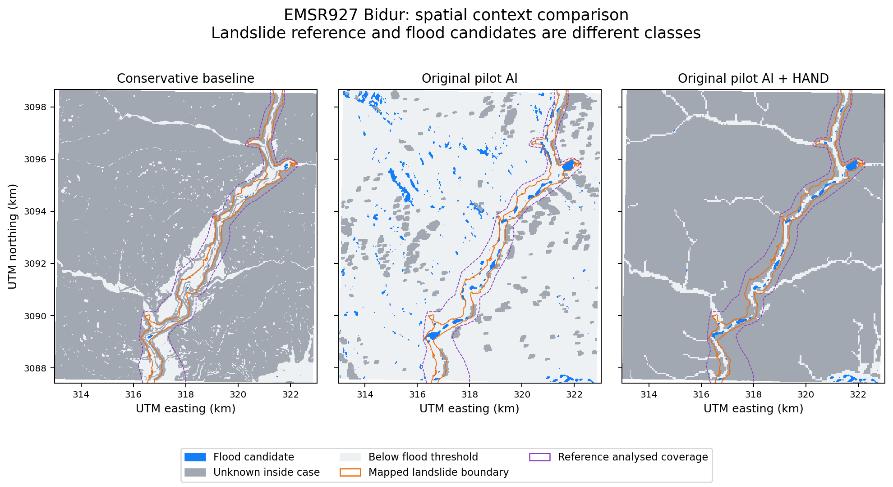

# EMSR927 Bidur: frozen spatial-context comparison

## Scope and conclusion

The supplied EMSR927 AOI03 Grading-Monit01 GeoPackage contains five observed-event polygons, all `6-Mass Movement / Landslide`, and no observed flood-water polygons. Its SHA256 matches the earlier context report. This evaluation measures spatial overlap with those landslide footprints and with graded reference infrastructure. It computes neither water-flood accuracy nor structural-damage classification accuracy. No model training, prediction changes, threshold tuning or inference was performed.

This closes the previous absence of a documented quantitative reference comparison for this package; it does not validate Himalayan flood mapping, evaluate all EMSR927 AOIs, or establish compliance with an unseen official rubric.

## Coverage and methodology

The reference AOI is intersected with imagery footprints associated with each feature's damage-source ID, excluding the package's not-analysed polygon. Pixel-centre masks are clipped to the case boundary inherited from the physical 20 m observability mask. This is aligned to the AI's 10 m grid with nearest-neighbour resampling, without claiming additional geometric accuracy. The reference landslide mask independently matches the earlier uploaded context raster.

- Reference analysed coverage inside the inherited case boundary: **12.0880 km2**.
- Mapped landslide footprint inside that boundary: **4.7904 km2**.
- Another **0.0705 km2** of mapped landslide lies in the raster rectangle but outside the case boundary and is excluded from the main table.
- RESURSP source imagery for observed landslides: **28 August 2026, 08:29 UTC**, stated 0.60 m resolution.
- Pilot SAR post-event observation: **28 August 2026, 12:21:41 UTC**, about 3 h 53 min later.
- Some infrastructure damage grades use PERUSAT imagery from 27 August instead. These dates are retained in the JSON and per-feature export.
- Fixed AI threshold: **0.5**. Checkpoint: the original pilot, not the newer candidate.

## Landslide-footprint accounting

Denominator: 4.7904 km2, including model-unknown terrain. A non-candidate pixel is not proof of dry land. A candidate overlapping a landslide is not a correct water-flood label.

| Method | Candidate overlap km2 | Candidate share | Unknown km2 | Unknown share |
|---|---:|---:|---:|---:|
| Conservative baseline | 0.0584 | 1.22% | 2.2334 | 46.62% |
| Original pilot AI | 0.7730 | 16.14% | 0.5013 | 10.46% |
| Original pilot AI + HAND | 0.5239 | 10.94% | 2.5500 | 53.23% |

HAND increases the unknown share within the reference landslide footprint from 10.46% to 53.23%. That is a coverage tradeoff; neither the reduced candidates nor agreement with a different hazard class establishes improved accuracy.

## Reference infrastructure comparisons

The original package has 670 road-line records: 662 have nonempty geometry, while 8 `No visible damage` records have empty geometry and cannot be located. Of the 662 located records, 445 intersect the evaluation coverage and 217 fall outside. Counts include partially covered road features; exact in-coverage candidate/non-candidate/unknown lengths are retained in the JSON.

Among **189 CEMS-destroyed road-line features intersecting coverage**:

| Frozen method | Any candidate intersection | Unknown present, no candidate | Below threshold, no unknown |
|---|---:|---:|---:|
| Baseline | 1 | 159 | 29 |
| Pilot AI | 34 | 26 | 129 |
| Pilot AI + HAND | 21 | 158 | 10 |

The source has 26 bridge points. There are **20 destroyed and 2 possibly damaged bridge points** inside evaluation coverage; 4 further destroyed points are outside.

For the **20 in-coverage destroyed bridge points**:

| Frozen method | Candidate pixel | Unknown pixel | Below-threshold pixel |
|---|---:|---:|---:|
| Baseline | 2 | 5 | 13 |
| Pilot AI | 6 | 1 | 13 |
| Pilot AI + HAND | 6 | 5 | 9 |

Bridge and building points are sampled at their exact pixel location with no tolerance tuning. This is not a one-to-one match to the OSM objects. The dashboard's five flagged OSM bridge ways therefore cannot be equated with six sampled CEMS bridge points. Bridge-water proximity can produce overlap without structural damage.

All 3,058 reference building points have geometry; 2,283 lie within evaluation coverage, and 775 are outside. Their damage-grade accounting is included in JSON/GeoJSON. Point locations and OSM building polygons are different representations, so these are not building-damage precision/recall estimates.

## Provenance and interpretation

- The AI mask hash matches the frozen inference manifest.
- AI+HAND was reconstructed from uploaded results ZIP `trinetra_93ca6f0a0f14.zip`; its rasterized candidate count equals the exported 6,702 pixels, and checkpoint/scene identity matches the raw pilot run.
- Baseline was aligned from 20 m for accounting only.
- All inputs were rehashed after evaluation and remained unchanged.
- The HAND export records OSM snapshot requested 25 August 2026, latest source availability 14 October 2026, and response hashes. This does not by itself certify the brief's data-access restrictions; those must be checked against the actual brief.
- No reference labels entered model inference or training. This standalone evaluator reads frozen outputs and writes comparison artifacts only.

## Files

- `emsr927_context_comparison.json`: hashes, source records, coverage, method accounting, damage-grade counts and road lengths.
- `reference_feature_comparison.geojson`: source reference geometries and per-method spatial status; this is not a damage-prediction layer.
- `emsr927_three_method_context.png`: three frozen methods with the reference landslide and analysed-coverage boundaries.
- `comparison_arrays.npz`: arrays used for the figure and accounting; grid metadata in JSON.
- `scripts/evaluate_emsr927_context.py`: reproducible, check-only evaluator; refuses an existing output directory.
- `tests/test_emsr927_context.py`: five boundary/alignment/accounting tests.

## Attribution

Reference: Copernicus Emergency Management Service, EMSR927 AOI03 Bidur Grading-Monit01, https://mapping.emergency.copernicus.eu/activations/EMSR927/. Preserve the original EU/Copernicus product credits. Derived comparison includes Copernicus Sentinel data (2026), with the original processing manifest retained separately. Historical infrastructure in the source HAND export: (c) OpenStreetMap contributors, ODbL, via HeiGIT ohsome. Model training dataset: Kuro Siwo, Bountos et al., NeurIPS 2024, DOI 10.52202/079017-1204; webdataset CC BY 4.0. These comparison outputs do not replace any exact attribution wording required by the official brief or original source licenses.
